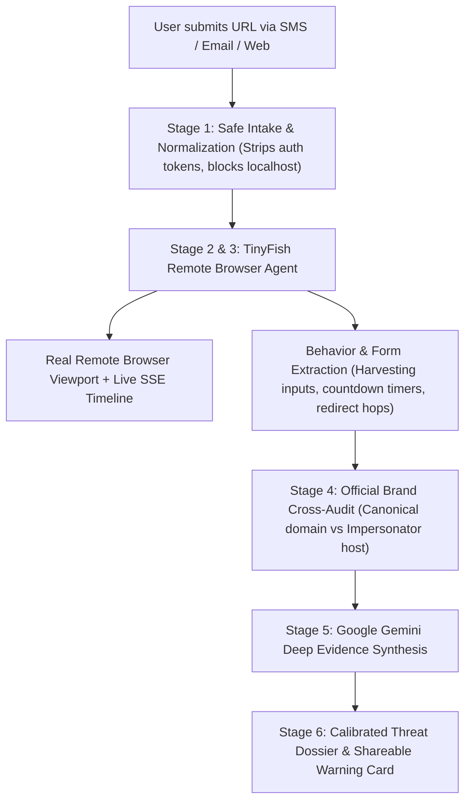

# VERITASLINK

> **"Don't Just Scan the Link. Investigate It."**

**VeritasLink** is a character-driven, agentic AI cybersecurity application designed to investigate suspicious URLs received via SMS, WhatsApp, Email, or messaging platforms. Instead of simply checking static domain reputation databases, VeritasLink deploys an isolated **TinyFish** remote browser agent to autonomously navigate the page, observe real-time deception behaviors, map redirection chains, identify sensitive credential harvesting forms, and synthesize evidence-backed threat reports powered by **Google Gemini**.

---

## 🎨 Visual Identity & Original AI Mascot — VERA

VeritasLink pairs an unconventional editorial and comic-inspired visual identity with serious cybersecurity forensic capabilities.

- **Palette:** Deep aubergine (`#260047`), Dark violet (`#35005B`), Electric purple (`#8127B5`), Magenta (`#F044D9`), Coral (`#FF786F`), Lavender (`#EED6F5`), Pale pink (`#FBE8FF`), Bright yellow (`#FFE65C`), Off-white (`#FFF9FF`).
- **Styling:** Bold oversized editorial typography, comic outlines, retro halftone dot patterns, asymmetrical layouts, and hard-edged drop shadows.

### Meet VERA — Visual Evidence & Risk Analyst
VERA is the original AI companion and personality of VeritasLink:
- **Design:** A floating digital investigator with a central magnifying-glass iris/eye assembly, an interlocking-link chest shield, deep violet chassis, lavender faceplate, and magenta/coral thruster pods.
- **Dynamic Reactive States:**
  1. `IDLE`: Curious and observant with surveying pupils.
  2. `SCANNING`: Concentric radar pulses and rotating optical reticle.
  3. `INVESTIGATING`: Target crosshairs locking onto forms and links.
  4. `SUSPICIOUS`: Narrowed squint with warning indicators.
  5. `THREAT DETECTED`: Alert warning expression with flashing coral sirens.
  6. `ASSESSMENT COMPLETE`: Confident curved eye with star sparkles and confetti.
  7. `INCONCLUSIVE`: Swirly inquisitive pupil with shrug cues.

VERA reacts in real time to the live status of the investigation workspace.

---

## ⚡ The Core Differentiator

| Traditional URL Scanners | VeritasLink Agentic Investigation |
| :--- | :--- |
| **Fails on 0-day domains:** 85% of phishing links are <24 hours old and not yet indexed in blocklists. | **Live Behavioral Inspection:** Navigates the actual website in an isolated cloud browser in real time. |
| **Bypassed by Geo & Anti-Bot Cloaking:** Threat actors display blank 404s to known scanner IPs. | **Stealth Puppeteering:** TinyFish uses anti-bot bypasses and residential proxies to observe true victim payloads. |
| **Blind to Interactive Funnels:** Only sees initial HTTP status code or static HTML. | **Full Deception Mapping:** Detects fake urgency timers, multi-step redirects, and OTP interception traps. |
| **Opaque Black-Box Score:** Outputs an unexplained number or false "Safe" guarantee. | **Transparent Forensic Dossier:** Every risk point is backed by observable evidence, DOM targets, and screenshots. |

---

## 🏗️ System Architecture



### Frontend Stack
- **React 18** with **TypeScript** and **Vite**
- **Tailwind CSS** with custom editorial halftone plugins and comic shadows
- **Framer Motion** for mascot animations and smooth state transitions
- **Lucide React** for technical iconography
- **Canvas Confetti** for assessment completion celebrations

### Backend Stack
- **Python 3.12** with **FastAPI**
- **Uvicorn** ASGI server with Server-Sent Events (SSE) streaming
- **SQLite** database for zero-config persistence of investigation dossiers
- **HTTPX** for async HTTP and TinyFish/Gemini API integration
- **Pydantic v2** for strict schema validation

---

## 🧪 Included Phishing Simulations (Demonstration Mode)

VeritasLink includes 3 built-in fictional phishing scenarios hosted locally:

1. **PowerGrid Urgent Disconnection Portal** (`http://powerbill-quickpay-alert.xyz/portal/verify`)
   - *Attack Vector:* SMS urgency notice demanding payment of overdue $14.80 bill within 14 minutes.
   - *Deceptions:* 14-minute fake countdown timer, direct credit card number and CVV input fields, untrusted `.xyz` domain impersonating state utility board.
2. **GlobalTrack Parcel Clearance Portal** (`http://track-parcel-redelivery-fee.top/auth/shipment`)
   - *Attack Vector:* Email claiming delivery is on hold at customs due to missing street number and $1.85 fee.
   - *Deceptions:* Multi-hop redirection cloaking origin server, harvests full home address and debit card for a low $1.85 fee to disarm user suspicion.
3. **Apex Trust KYC Compliance Suspension** (`http://apex-kyc-compliance-update.live/secure/login`)
   - *Attack Vector:* WhatsApp alert warning that NetBanking will be suspended in 24 hours per regulatory mandate.
   - *Deceptions:* Direct capture of customer ID, password, transaction PIN, and two-factor SMS OTP interception screen.

---

## 🚀 Windows Quick Start

### Prerequisites
- Python 3.10+ (Python 3.12 recommended)
- Node.js 18+ (Node 22 installed)
- PowerShell or Command Prompt

### Option A: 1-Click Launch (Recommended)
Double-click `start.bat` or run in PowerShell:
```powershell
.\start.ps1
```
This automatically launches both the FastAPI backend (port 8000) and the React frontend (port 3000) in separate terminal windows.

### Option B: Manual Setup

#### 1. Backend Setup
```powershell
cd backend
python -m pip install -r requirements.txt
python run.py
```
Backend will start on: `http://127.0.0.1:8000`  
API Swagger Docs: `http://127.0.0.1:8000/docs`

#### 2. Frontend Setup
In a new terminal:
```powershell
cd frontend
npm install
npm run dev
```
Open your browser at: `http://localhost:3000`

---

## 🔑 Environment Configuration (.env)

Copy `.env.example` to `.env` in the root or `backend/` directory:

```env
# TinyFish Web Agent API (Optional - engages built-in demo adapter if not set)
TINYFISH_API_KEY=
TINYFISH_BASE_URL=https://agent.tinyfish.ai

# Google Gemini API for Evidence Synthesis (Optional - engages deterministic rule engine if not set)
GEMINI_API_KEY=
GEMINI_MODEL=gemini-2.5-flash

# Server Configuration
HOST=127.0.0.1
PORT=8000
```

> **Note on Hackathon Evaluation:**  
> If external API keys are not provided, VeritasLink runs completely offline using its calibrated local simulation engine and deterministic evidence synthesizer. All features—including the live browser viewport, SSE timeline, brand comparison, and exportable warning cards—work seamlessly out-of-the-box.

---

## 🔒 Security Principles

- **Zero-Submission Guarantee:** The remote browser agent strictly never auto-fills or submits credentials, passwords, or payments on investigated websites.
- **Isolated Cloud Browser:** Target URLs execute exclusively in remote Chromium sandboxes; malicious JavaScript or exploit kits never execute on the user's device.
- **SSRF & Loopback Protection:** The backend rejects any submission resolving to `localhost`, `127.0.0.1`, `10.0.0.0/8`, `192.168.0.0/16`, or cloud metadata endpoints (`169.254.169.254`).
- **No False "Safe" Claims:** Following strict cybersecurity guidelines, VeritasLink never marks an unflagged link as "Safe"—it clearly distinguishes between verified low-risk signals and unverified or cloaked endpoints.

---

## 📄 License
Built for the **TinyFish Hackathon**. MIT License.

